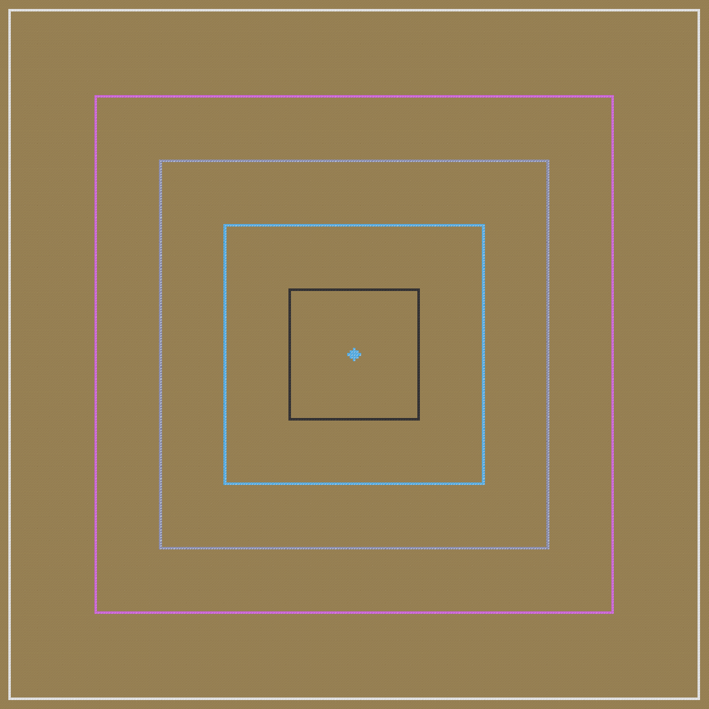

---
navigation:
  title: "Flight Pylon"
  icon: "yet_another_industrialization:flight_pylon"
  position: 0
  parent: yet_another_industrialization:utilities.md
item_ids:
  - yet_another_industrialization:flight_pylon
---

# Flight Pylon
###### *Icarus's dream*

<GameScene zoom="2" interactive={true} fullWidth={true}>
    <MultiblockShape controller="yet_another_industrialization:flight_pylon" />
    <MultiblockShape controller="yet_another_industrialization:flight_pylon" useBigShape={true} x="-7" />
    <IsometricCamera yaw="190" pitch="15" />
</GameScene>

Flight Pylons work as electric beacons... if beacons provided "only" creative flight. Unlike beacons however, Flight Pylons don't require direct skylight and can have their beam disabled within the UI.

Usually, you'll be able to unlock them during MV:

<Recipe id="yet_another_industrialization:craft/flight_pylon_jetpack" />

However, you can use an Elytra (which you can clone using [Dragon's Breath](../utilities/fluids.md)) to craft it early during LV:

<Row>
    <Recipe id="yet_another_industrialization:craft/flight_pylon_elytra" />
    <Recipe id="yet_another_industrialization:mixer/elytra_duplication" />
</Row>

Pylons have multiple tiers, each increasing the effect's range and EU required. Check your recipe viewer for further details.

For reference, check the ranges of all default tiers (24, 48, 72, 96 and 128 block ranges respectively):

